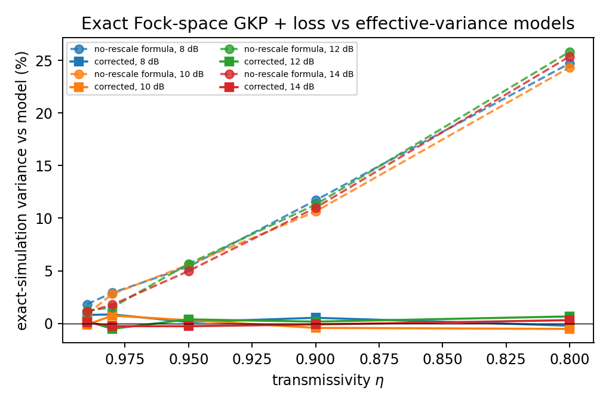
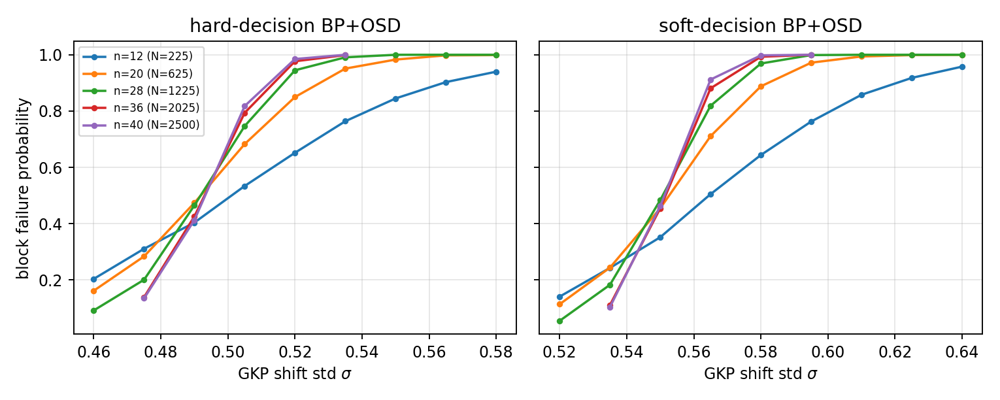
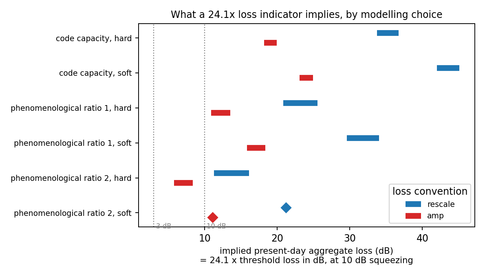
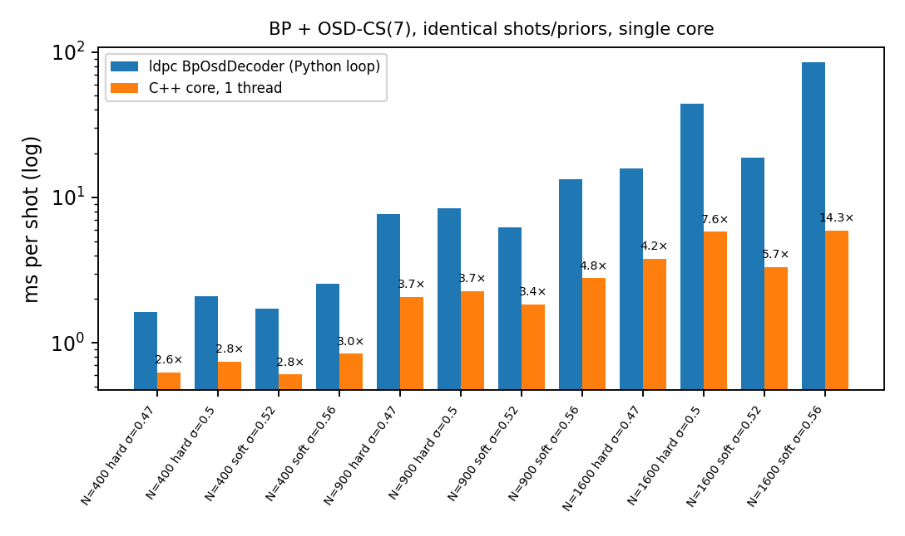
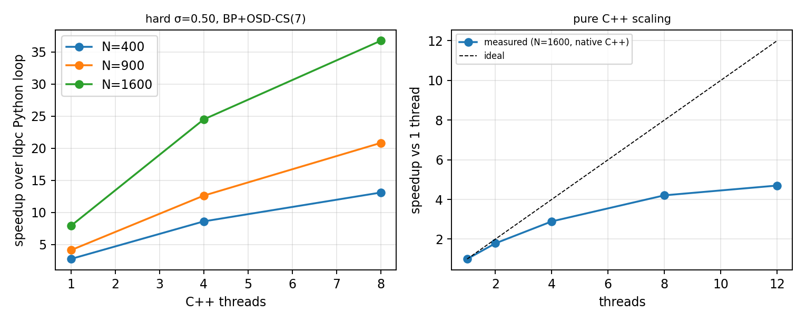
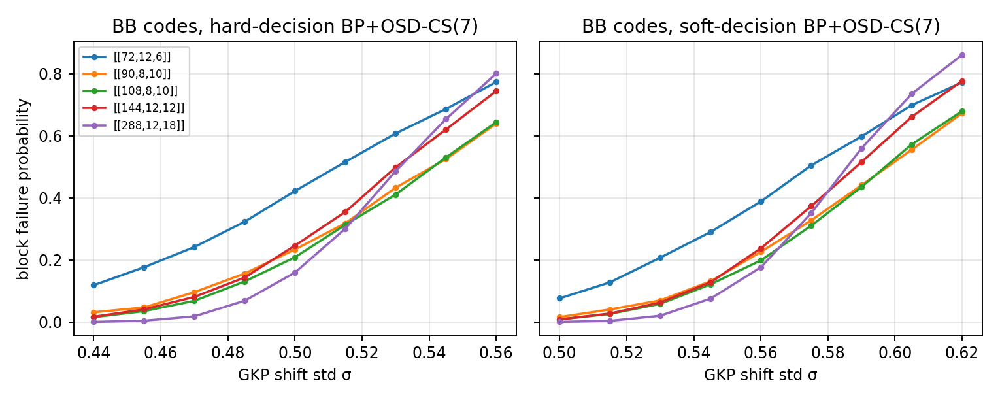

# gkp-qldpc-thresholds

**Verified tools for turning GKP–qLDPC code thresholds into physical units: squeezing and photon loss.**

Published thresholds for GKP-concatenated qLDPC codes are quoted in an abstract noise parameter *σ*. Hardware roadmaps are quoted in
decibels of squeezing and loss. This repository is the bridge between the two, built so that every step can be checked:
an exact Fock-space test of the loss channel, regression-tested decoders, and validation gates that reproduce published numbers
before anything new is claimed.



*Exact simulation of a finite-energy GKP state through pure loss, against two effective-variance models. A formula that omits the lattice
rescaling (dashed) is off by up to +26 % in variance at η = 0.8; the corrected model (solid) stays within ±0.9 %.*

## What is in the box

| | |
|---|---|
| `gkp_qldpc.channel` | GKP shift/loss channel: exact flip probability (full periodic sum), posterior flip probabilities from analog residuals, inverse maps from a threshold σ to a threshold loss at a given squeezing, for two loss conventions |
| `gkp_qldpc.fock` | First-principles check: finite-energy GKP in the Fock basis, exact Kraus loss, exact homodyne marginal |
| `gkp_qldpc.codes` | Hypergraph-product and toric codes; **screened random (3,4)-LDPC ensemble** (fixed *k*, distance floor); GF(2) logical-failure checks |
| `gkp_qldpc.decoders` | BP+OSD with hard priors or per-shot **soft priors** from GKP analog residuals (code capacity) |
| `gkp_qldpc.phenom` | Space-time detector matrix; phenomenological noise with noisy readout through GKP ancillas, hard vs soft |
| `gkp_qldpc.fastdec`, `fastsweep`, `cpp/` | **C++ BP + OSD core** (header-only, pybind11, OpenMP) with per-shot soft priors; bit-identical BP stage to `ldpc`; vectorised sweeps |
| `gkp_qldpc.codes` (BB) | bivariate-bicycle family [[72,12,6]] ... [[288,12,18]] (N and k verified in tests) |
| `gkp_qldpc.stats` | Pairwise finite-size crossings with cluster bootstrap and **distance-aware pair classification** |
| `scripts/` | Gates 0–4, resumable multiprocessing sweeps, analysis, figures |
| `tests/` | 31 tests, about 16 s: channel math, Fock-space regression, code constructions, decoders, statistics, and the C++ core against `ldpc` (C++ tests skip if the extension is not built) |

## Results at a glance

Everything below is reproducible from `scripts/`; the raw per-job CSVs go in `data/raw/`.

| Check | This repo | Reference |
|---|---|---|
| Loss channel, exact Fock simulation vs corrected model (8–16 dB, η 0.8–0.99) | within ±0.9 % in variance | n/a (first-principles) |
| Same, vs formula without lattice rescaling | up to +26 % | n/a |
| Toric code, independent bit flips, MWPM threshold | 0.1043 ± 0.0003 (fit) | 0.1031 ± 0.0001, Wang–Harrington–Preskill. Passes a pre-registered 0.002 tolerance, but sits about 4σ above statistically (fit systematics) |
| Code capacity, hard-decision BP+OSD, screened HGP(3,4), N up to ~3000 | σ_c ≈ 0.50 ± 0.01 | 0.505 (LP04 lifted-product family, min-sum, Raveendran et al.), 0.500 (bivariate-bicycle, Yao et al.) |
| Code capacity, analog (soft) decoding | σ_c ≈ 0.555 ± 0.01 | 0.557 (Raveendran et al.), 0.556 (Yao et al.) |
| Soft-over-hard gain in σ, 8 neighbouring size pairs | 0.054 ± 0.005 | 0.052 (Raveendran et al.) |
| BB codes [[144,12,12]] vs [[288,12,18]], block-failure crossing (C++ decoder) | hard 0.534 ± 0.002, soft 0.580 ± 0.002, shift 0.046 | Yao et al. report 0.500 / 0.556 for BB. **Our BB crossings are about 0.03 higher; unresolved, see below** |



### What the thresholds mean in loss (10 dB squeezing)

| Outer-code threshold model | Threshold loss, rescale convention | Threshold loss, amplifier convention |
|---|---|---|
| Code capacity, hard / soft | 29 % / 34 % | 17 % / 21 % |
| Phenomenological, ratio 1.0, hard / soft | 18–22 % / 25–28 % | 10–12 % / 14–16 % |
| Phenomenological, ratio 2.0, hard / soft | 10–14 % / about 18 % | 5–8 % / about 10 % |

"Ratio" is the ancilla-readout noise divided by the data noise per round. The phenomenological rows are **brackets**, not clean thresholds
(see *Caveats*).

## Why this exists

A hardware roadmap states a loss indicator as a ratio of hardware loss to a loss requirement. Can published outer-code threshold theory
reproduce such a number? Answering that needs three conversions that are easy to get wrong: noise parameter to loss, hard to analog decoding,
and code capacity to noisy readout. The result is mostly a map of how much each modelling choice moves the answer:



Reading an indicator of 24.1 literally as (threshold loss in dB) × 24.1 gives an implied present-day aggregate loss that ranges from roughly
**6 dB to 45 dB** across these choices. That is a spread of more than a factor of seven coming from conventions that public documents don't fix.
This repository does not claim any hardware roadmap is feasible or infeasible. It quantifies what code-level theory can and cannot pin down.

## C++ decoder core

`cpp/include/gkpbp/decoder.hpp` is a header-only normalised min-sum BP with OSD-0 and OSD-CS post-processing and **per-shot prior LLRs**
(what GKP analog information needs). `python cpp/build.py` compiles the pybind11 module; `FastBpOsd.decode_batch` decodes a whole batch with OpenMP.

**How it was validated** (all of it is in `tests/test_cpp.py`):

| Check | Result |
|---|---|
| BP stage vs `ldpc.BpDecoder`, hard and per-shot soft priors, three noise levels | **bit-identical** outputs, convergence flags and iteration counts (9,000+ shots) |
| OSD-0 vs `ldpc` `osd_0` | 99.8 % identical outputs; every output satisfies the syndrome; the 0.2 % that differ are tie-breaks in the column sort, with equal or lower weight |
| OSD-CS(7) vs `ldpc` `osd_cs`, block failure | z = +0.35, 0.00, −0.30 at three points; 94–97 % identical outputs |
| Thread count | identical outputs for 1 and 3 threads |
| Fast sweep functions vs the Python implementations | statistically indistinguishable (code capacity and phenomenological) |

**A lesson from the build.** My first OSD-CS swept weight-1 patterns only over the first λ non-pivot columns. It lost 6–8 points of block-failure rate
to `ldpc` (z ≈ 5–6) while OSD-0 and BP matched exactly. Sweeping weight-1 over **every** non-pivot column and weight-2 pairs among the first λ fixed it.
The test that caught this is now a regression test.

**Speed.** Identical shots, priors and settings (min-sum, 100 iterations, OSD-CS 7), one core of a cloud sandbox, per-shot soft priors for the `ldpc` loop:



| Qubits N | Speedup vs `ldpc` Python loop | Pure C++ (no Python), near threshold |
|---|---|---|
| 400 | 2.6–3.0× | 0.5–0.7 ms/shot |
| 900 | 3.4–4.8× | 1.8–2.0 ms/shot |
| 1600 | 4.2–14.3× | 3.9–5.0 ms/shot |

Failure rates agree between the two decoders on every benchmark point (|z| ≤ 0.2). The `ldpc` loop includes Python call and prior-update overhead, which is
unavoidable for per-shot soft priors, so part of the small-N gap is API overhead; the native benchmark (`cpp/bench/bench_native.cpp`) isolates the C++ cost.
**Multi-core.** Measured on the author's laptop (Ubuntu 24.04 under WSL, 12 logical cores), same shots and priors, 600 shots per point:



| Qubits N | Speedup over `ldpc` loop, 1 thread | 4 threads | 8 threads |
|---|---|---|---|
| 400 | 2.5–3.2× | 7.5–10.3× | 11.2–14.9× |
| 900 | 3.3–4.7× | 9.1–14.9× | 14.5–22.7× |
| 1600 | 4.3–16.3× | 13.0–50.1× | 16.8–77.1× |

Failure rates again agree on every row (|z| ≤ 0.25). The C++ core on its own (`cpp/bench/bench_native.cpp`, N = 1600, hard σ = 0.50, 2000 shots) takes
3250 µs/shot on one thread and 1818, 1124, 772 and 692 µs/shot on 2, 4, 8 and 12 threads: a speedup of 1.79×, 2.89×, 4.21× and 4.70×
(parallel efficiency 90 %, 72 %, 53 %, 39 %). Scaling flattens beyond 8 threads. I have not investigated why (shared cores or memory bandwidth are plausible);
the results are identical across thread counts. Reproduce with `python scripts/bench_decoders.py 16,24,32 600 1,4,8` and the native loop in `cpp/bench/`.

## Bivariate-bicycle cross-check

`gkp_qldpc.codes.BB_CODES` holds the five published BB codes. N and k are verified (72/12, 90/8, 108/8, 144/12, 288/12); distances are quoted from the literature,
not recomputed. With the C++ decoder the whole code-capacity sweep (5 codes × 18 σ × 6000 shots) takes minutes.



| Pair | Hard crossing σ | Soft crossing σ | Note |
|---|---|---|---|
| 72 vs 90 | not found | not found | the larger code is better at every σ scanned |
| 90 vs 108 | 0.542 ± 0.016 | 0.594 ± 0.014 | same distance (10): multiplicity-dominated, do not quote |
| 108 vs 144 | unresolved | 0.502 ± 0.013 | the curves nearly overlap |
| **144 vs 288** | **0.534 ± 0.002** | **0.580 ± 0.002** | distance 12 → 18; shift 0.046 |

Soft-over-hard shifts (0.046–0.052) match the HGP result. **The absolute crossings do not match Yao et al.'s 0.500 / 0.556**: ours are about 0.03 higher.
I have not resolved why. Candidates: their crossing definition or normalisation, decoder settings, noise definition, and the fact that block failure here compares codes with
different *k* (8 vs 12). Until that is understood, the BB numbers are a consistency check on the *shift*, not a confirmation of the absolute thresholds, and the earlier
agreement between our HGP numbers and their BB numbers should be read as partly coincidental.

## Findings that may be useful to decoder people

1. **The code lottery.** Random (3,4)-regular codes at n ≤ 48 have classical distance anywhere from 2 to 12 at the same size. One d = 2
   code at n = 16 had block failure 0.52 at σ = 0.44 against 0.13 for its sibling code, and wrecked a whole crossing. Use fixed rank and a distance floor
   (`make_good_code`).
2. **Block failure vs per-logical-qubit failure.** For constant-rate codes, *k* grows with *N*, so any-logical-error crossings drift
   down with size, while per-qubit normalisation (which assumes independent logical failures) saturates. The scripts record both.
3. **Equal-distance neighbours are not a threshold.** A crossing between sizes with the same distance measures minimum-weight-logical
   multiplicity. `analyze_pairwise.py` tags each pair `clean`, `same` or `mixed`, and loss tables use clean pairs only.
4. **Single-collapse fits fail honestly.** The textbook one-parameter collapse gave reduced χ² of 29–44 on this data. The pairwise approach
   shows why: the crossings of neighbouring pairs genuinely differ by about 0.02.
5. **Soft information gain is the robust quantity.** Absolute finite-size thresholds scatter by about ±0.02, but the soft-minus-hard shift
   is steady (0.046–0.060 across eight pairs).
6. **Cost.** Space-time BP+OSD at n = 24 (6 rounds, about 10⁴ variables) took about 11 h on 10 cores for one ratio; n ≤ 20 took about 3 h.

## Quickstart

```bash
git clone https://github.com/vishal1601-2005/gkp-qldpc-thresholds
cd gkp-qldpc-thresholds
pip install -e ".[dev]"
pytest -q                                   # 31 tests, about 16 s (C++ tests are skipped if the extension is not built)

python cpp/build.py                         # optional: compile the C++ decoder core (needs g++/clang++ and pybind11)
python scripts/gate1_fock_check.py 10       # exact loss channel vs models (seconds)
python scripts/gate0_threshold_loss_table.py
python scripts/gate2_toric_mwpm.py 20000    # toric + MWPM threshold (about 2 min)
python scripts/gate4_phenom_check.py 2500   # phenomenological code reduces to code capacity (minutes)

# production sweeps (resumable, one CSV line per finished job)
python scripts/layer_a_sweep.py 1500 4 <cores> 12,16,20,24,28,32,36,40,44
python scripts/layer_b_sweep.py 1000 4 <cores> 12,16,20 1.0      # ratio 1.0; add a 6th argument to shift the sigma window
python scripts/analyze_pairwise.py layer_a_results.csv
python scripts/make_figures.py
python scripts/bench_decoders.py 16,24,32 600 1,4,8      # ldpc vs C++ (needs the extension)
python scripts/bb_code_capacity.py 6000 4               # BB-code hard vs soft crossings with the C++ decoder
```

```python
import numpy as np
from gkp_qldpc import s0sq_from_dB, eta_threshold, sigma_from_p

s0 = s0sq_from_dB(10)                      # 10 dB squeezing
sigma_c = 0.555                            # an analog-decoding threshold in sigma
for conv in ("rescale", "amp"):
    print(conv, 100 * (1 - eta_threshold(sigma_c, s0, conv)), "% threshold loss")
```

## Validation philosophy

Pass criteria were written before running, and deviations are disclosed rather than tidied:

- **Gate 1:** the pre-registered criterion was 5 % relative error in the logical error probability. It failed at one point (10 dB, η = 0.98: 5.3 %).
  Because p_L ~ exp(−π/8σ²) magnifies sub-percent variance differences, a variance-space criterion (1 %) was **added afterwards**, and the script labels it that way.
- **Gate 4** (T = 1 and no measurement noise must reproduce code-capacity decoding): passes at 3σ, but hard decoding shows a small unexplained excess
  (about +0.017 in failure rate, about 0.0015 in σ, z ≈ 2.3–2.6). Soft decoding agrees.
- **Gate 2** passes at the 0.002 tolerance but is about 4σ off statistically.

## Caveats (please read)

- **No circuit-level noise.** The phenomenological layer has noisy readout bits but no gates, scheduling or ancilla back-action. For circuit-level
  GKP–qLDPC studies see Borah et al. and Yao et al. below.
- **Layer-(b) results are brackets.** They come from sizes n = 12–24 where n = 16 mixes distances 4, 6 and 8 and n = 20, 24 share distance 6. Crossings
  fall with size (about 0.03 per step), so the asymptotic phenomenological threshold is probably at or below the quoted values.
- **Gaussian-displacement model.** Pure loss on an approximate GKP qubit is not a Pauli channel (Harris et al.). The Fock check verifies the
  bit-flip probability of the x-marginal, not the full logical channel.
- **BB distances are quoted, not computed**, and the BB absolute crossings disagree with a published value (see above).
- **Benchmarks come from two machines:** the single-core figure and table use one core of a cloud sandbox; the multi-core results use one 12-logical-core laptop under WSL. Scaling beyond 8 threads is poor and unexplained.
- **Small codes.** Random HGP(3,4), N up to about 3000, 1500 shots × 4 codes per point. Not a substitute for the large-N studies cited below.
- **Roadmap mapping.** An aggregate over many components is not a single-mode loss. The "implied present-day loss" is a reading of one indicator
  under stated conventions, not an inference about any device.

## Related work

(Threshold numbers quoted from these papers are as I read them; check the original tables before citing them.)

- N. Raveendran et al., *Finite rate QLDPC-GKP coding scheme that surpasses the CSS Hamming bound*, Quantum 6, 767 (2022), arXiv:2111.07029
- L. Berent et al., *Analog information decoding of bosonic quantum LDPC codes*, PRX Quantum 5, 020349 (2024), arXiv:2311.01328
- S. K. Borah et al., *Fault tolerant decoding of QLDPC-GKP codes with circuit level soft information*, arXiv:2505.06385
- Yao et al., *Circuit-level benchmarks of GKP-concatenated qLDPC codes*, arXiv:2609.35282 (independent, near-simultaneous; reports BB crossings of about 0.500 hard / 0.556 analog, close to our HGP numbers but about 0.03 below our own BB measurements, see the BB section)
- A. Grospellier et al., *Combining hard and soft decoders for hypergraph product codes*, Quantum 5, 432 (2021), arXiv:2004.11199
- I. Tzitrin et al., *Fault-tolerant quantum computation with static linear optics*, PRX Quantum 2, 040353 (2021), arXiv:2104.03241
- Walshe et al., *Linear-optical quantum computation with arbitrary error-correcting codes*, PRL 134, 100602 (2025), arXiv:2408.04126
- Harris, Menicucci, Guha, *Logical channel for heralded and pure loss with the GKP code*, arXiv:2504.13497
- K. Noh, V. V. Albert, L. Jiang, IEEE Trans. Inf. Theory 65, 2563 (2019), arXiv:1801.07271

## Author, citation, license

Vishal Hiralal Thakur · ORCID [0009-0008-8406-0508](https://orcid.org/0009-0008-8406-0508) · [github.com/vishal1601-2005](https://github.com/vishal1601-2005)
See `CITATION.cff`. MIT license.
